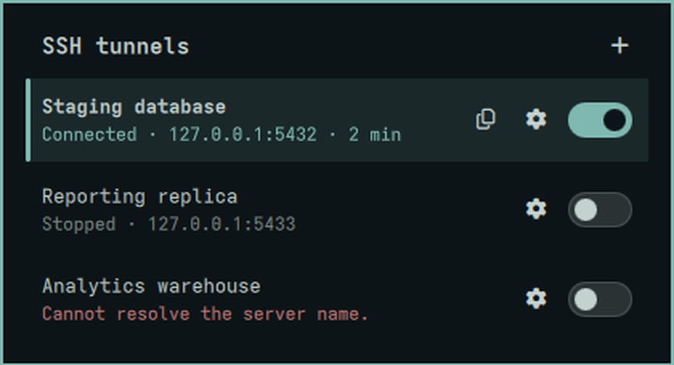
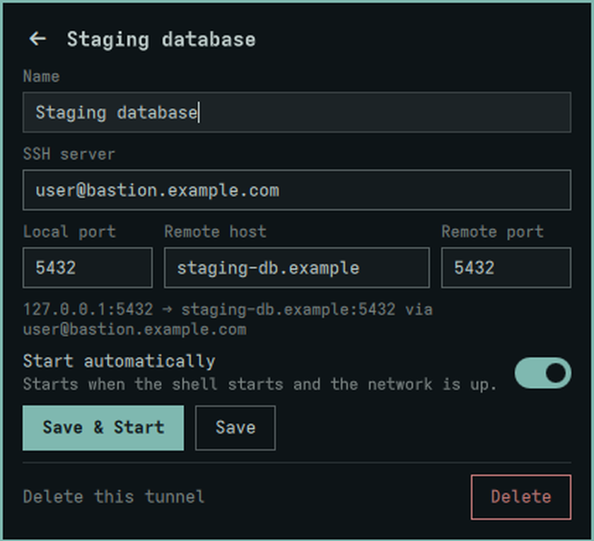

# Conduit Tunnel

**An SSH tunnel manager for the [Omarchy](https://omarchy.org) bar.** Keep the port forwards you use every day, such as a database behind a bastion host, one click away: start and stop them, see which are up, copy their address, and get told when one drops.

It turns commands like `ssh -N -L 5432:db.example:5432 user@bastion.example.com` into a list with switches. Each tunnel runs as a `systemd --user` service, so it survives a shell restart and is restarted by systemd when it fails.

Part of the **Conduit** family, with [Conduit VPN](https://github.com/andriar/omarchy-conduit-vpn). The two share one look ([DESIGN.md](https://github.com/andriar/omarchy-conduit-vpn/blob/main/DESIGN.md)).

> The popup follows the language you pick under Omarchy's **Setup > Language**. English and Indonesian are included.

## Screenshots

<table>
  <tr>
    <td align="center"></td>
    <td align="center"></td>
  </tr>
  <tr>
    <td align="center">The list</td>
    <td align="center">Editing a tunnel</td>
  </tr>
</table>

The screenshots use made-up names and addresses.

## Features

- **One list of tunnels** with live status: `Connected · 127.0.0.1:5432 · 11 min`.
- **Start and stop** with a switch, or from the command line and keybindings (see below).
- **Add, edit and delete** tunnels in the popup: a name, the SSH server, a local port, and the remote host and port.
- **Start automatically**: mark the tunnels you always need. They start when the shell starts and the network is up, once per session, so a tunnel that fails is not retried in a loop and one you stopped yourself stays stopped.
- **Copy the address** (`127.0.0.1:<port>`) with one click once it is up.
- **Failures say why**: host key not trusted yet, login refused, name does not resolve, server unreachable, local port in use.
- **Drop notification** when a tunnel that was up goes away by itself. A tunnel you stop yourself stays quiet.
- **Ask for password** (optional, per tunnel): for a server that only takes a password. A dialog asks each time you start the tunnel, and the password goes straight to `ssh`. Nothing is stored, and such a tunnel never starts or restarts by itself (see [Password tunnels](#password-tunnels)).
- **Safe by default**: listens on `127.0.0.1` only, never prompts unless you turned on *Ask for password* (so it cannot hang), and gives up after five failed restarts in two minutes instead of looping forever.
- Works with your `~/.ssh/config`: the SSH server can be a `Host` alias, so `ProxyJump`, `IdentityFile` and friends apply.

## Requirements

- Omarchy with shell plugins (the `omarchy plugin` command) and a `systemd --user` session (Omarchy has both).
- The OpenSSH client (`ssh`).
- A key that works without a prompt: **without a passphrase**, or **loaded in an `ssh-agent`** (see [ssh-agent](#ssh-agent-keys-with-a-passphrase)). The widget runs `ssh` in batch mode, so it cannot ask for a passphrase.
- `wl-clipboard` for the copy button (optional).
- `zenity` for the password dialog (only if you use *Ask for password*; Omarchy ships it).

## Install

```bash
omarchy plugin add https://github.com/andriar/omarchy-conduit-tunnel.git --enable
```

The widget lands on the right side of the bar. Move it where you like:

```bash
omarchy bar move conduit.tunnel --after conduit.vpn
```

Update and remove:

```bash
omarchy plugin update conduit.tunnel
omarchy plugin remove conduit.tunnel
```

Your tunnel list is kept in `~/.config/omarchy-conduit-tunnel/tunnels.json` and is not touched when you remove the widget.

### Manual install

```bash
git clone https://github.com/andriar/omarchy-conduit-tunnel.git ~/.config/omarchy/plugins/conduit.tunnel
omarchy plugin enable conduit.tunnel
```

## Using it

1. Click the arrows icon in the bar to open the list.
2. **+** adds a tunnel. Fill in a name, the SSH server (`user@host` or a `Host` from `~/.ssh/config`), the local port to listen on, and the host and port to reach from the SSH server. Press **Save & Start**.
3. The switch starts and stops a tunnel. Point your database client at `127.0.0.1:<local port>`.
4. The gear edits or deletes a tunnel, and holds the **Start automatically** switch.

**First connection to a server.** The widget never accepts an unknown host key for you. If the row says the host key is not trusted, run `ssh user@host` once in a terminal, answer `yes`, and start the tunnel again.

### From the command line

```bash
omarchy-shell conduit.tunnel status                 # id, name, state, address
omarchy-shell conduit.tunnel start "Staging database"
omarchy-shell conduit.tunnel stop  "Staging database"
omarchy-shell conduit.tunnel toggle                 # open or close the popup
```

Bind any of these to a key in your Hyprland config. Each tunnel is also a normal systemd unit, named `conduit-tunnel-<id>.service`:

```bash
systemctl --user status conduit-tunnel-<id>
journalctl --user -u conduit-tunnel-<id>
```

## ssh-agent (keys with a passphrase)

A key **without** a passphrase needs nothing here. A key **with** a passphrase has to be unlocked once per login and held by an `ssh-agent`, because the widget cannot type a passphrase for you.

1. **Start the agent.** Omarchy ships OpenSSH's socket-activated user service:

   ```bash
   systemctl --user enable --now ssh-agent.socket
   ```

   Its socket is `$XDG_RUNTIME_DIR/ssh-agent.socket`.

2. **Let your terminals find it.** Add this line to `~/.bashrc`, then open a new terminal:

   ```bash
   export SSH_AUTH_SOCK="$XDG_RUNTIME_DIR/ssh-agent.socket"
   ```

3. **Load your key** (it asks for the passphrase once per login):

   ```bash
   ssh-add
   ```

   Or put `AddKeysToAgent yes` in `~/.ssh/config`, and the first `ssh` you run loads the key for you.

4. **Check it:** `ssh-add -l` lists the key.

You do **not** have to restart anything for Conduit: when the shell has no `SSH_AUTH_SOCK`, tunnels look for the agent at `$XDG_RUNTIME_DIR/ssh-agent.socket` (and the GNOME keyring and gcr sockets) by themselves. Only your terminals need step 2. The agent forgets your key when you log out or reboot, so run `ssh-add` again after that.

## Password tunnels

Most bastions take a key, and a key is the better choice: it needs no dialog and the tunnel can start by itself. Some only take a password, or you have not registered your key yet. For those, turn on **Ask for password** in the tunnel's edit form.

- Each time you start the tunnel, a small dialog asks for the password and hands it straight to `ssh` (through `SSH_ASKPASS`). It is never written to a file, a log or `tunnels.json`.
- The dialog only answers password, passphrase and one-time-code prompts. A **host key question is always refused**, so an unknown host still fails with "host key not trusted yet" and you accept it once in a terminal, as usual.
- `ssh` gets **one** password attempt per start. The tunnel is **not restarted by itself**: a retry loop would pop the dialog up again and again, and a wrong password could lock your account on the server. If the connection drops you get the usual notification, and you start it again from the list.
- It never starts automatically (the *Start automatically* switch is hidden for these tunnels): a dialog out of nowhere at login would be a surprise.
- Cancel the dialog, or wait two minutes, and the start fails with "Login refused".

## Security and privacy

- **No secrets are stored.** Authentication is your SSH key. A tunnel with *Ask for password* asks you in a dialog each time; the password goes to `ssh` and nowhere else.
- Tunnels are saved in `~/.config/omarchy-conduit-tunnel/tunnels.json`, readable only by you (`0600`). It holds hostnames, so it is never part of this repository, and `.gitignore` and `scripts/check.sh` keep it out.
- Tunnels listen on **`127.0.0.1` only**, never on `0.0.0.0`.
- Every value you type is validated against a strict pattern, both in the popup and again in the shell script, before it reaches an `ssh` command line. A server name that starts with `-` or contains spaces or shell characters is rejected.
- Host keys are checked as usual (`StrictHostKeyChecking` is not weakened; the password dialog refuses host key questions) and `BatchMode` is on, so nothing waits for a prompt nobody can answer. The one exception is a tunnel with *Ask for password*, which turns `BatchMode` off for that tunnel and answers only through the dialog.
- The widget makes **no network requests** of its own beyond the `ssh` connections you configure.
- Omarchy shell plugins run **unsandboxed**. Read the code before you install any plugin, including this one.
- Do not post your `tunnels.json`, `~/.ssh/config` or logs in issues: they contain your real hostnames.

## Troubleshooting

| What the row says | Likely cause |
|---|---|
| "The server's host key is not trusted yet" | First connection to that server. Run `ssh user@host` once in a terminal and accept the key. |
| "Login refused" | Your key is not accepted, or it has a passphrase and no `ssh-agent` holds it (see [ssh-agent](#ssh-agent-keys-with-a-passphrase)). On a password tunnel: the password was wrong or the dialog was cancelled. Try `ssh user@host` in a terminal. |
| "Cannot resolve the server name" | A typo in the SSH server, or no DNS or network. |
| "Cannot reach the server" | The SSH server is down, firewalled, or on another port (set it in `~/.ssh/config`). |
| "The local port is already in use" / "Port N is already in use by another program" | Pick another local port, or stop the program using it (`ss -ltnp 'sport = :5432'`). |
| Connected, but the database client cannot connect | The SSH server cannot reach the remote host and port you entered. Test from the SSH server itself. |
| A tunnel marked "Start automatically" did not start | It starts once per session, as soon as there is a network. If the SSH server was not reachable yet at that moment, the first attempt fails: start the tunnel from the popup once the server can be reached. |
| Switch turns itself off again | After five failures in two minutes systemd stops retrying. Fix the cause shown in the row, then start it again. |

## Roadmap

- Import `LocalForward` entries from `~/.ssh/config`.

## Contributing

`main` is protected: open a pull request. Run `scripts/check.sh` before you push (CI runs the same script). See [CONTRIBUTING.md](CONTRIBUTING.md).

## License

[MIT](LICENSE)

---

## Instalasi singkat (Bahasa Indonesia)

```bash
omarchy plugin add https://github.com/andriar/omarchy-conduit-tunnel.git --enable
```

Klik ikon panah di bar, tekan **+**, isi nama, server SSH (`user@host` atau `Host` dari `~/.ssh/config`), port lokal, serta host dan port tujuan, lalu **Simpan & Mulai**. Arahkan aplikasi database ke `127.0.0.1:<port lokal>`. Nyalakan **Start automatically** di pengaturan tunnel supaya menyala sendiri saat shell mulai dan jaringan aktif. Tunnel hanya mendengarkan di `127.0.0.1`, tidak menyimpan password apa pun (autentikasi lewat kunci SSH), dan daftar tunnel hanya tersimpan di mesinmu. Kalau diminta mempercayai host key, jalankan `ssh user@host` sekali di terminal. Kalau kunci SSH-mu memakai passphrase, nyalakan agent dengan `systemctl --user enable --now ssh-agent.socket`, tambahkan `export SSH_AUTH_SOCK="$XDG_RUNTIME_DIR/ssh-agent.socket"` ke `~/.bashrc`, lalu jalankan `ssh-add` sekali setiap login (langkah lengkap di bagian ssh-agent). Tampilan mengikuti bahasa Omarchy (Setup > Language).
